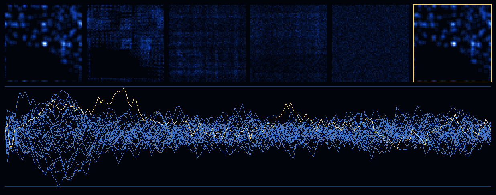
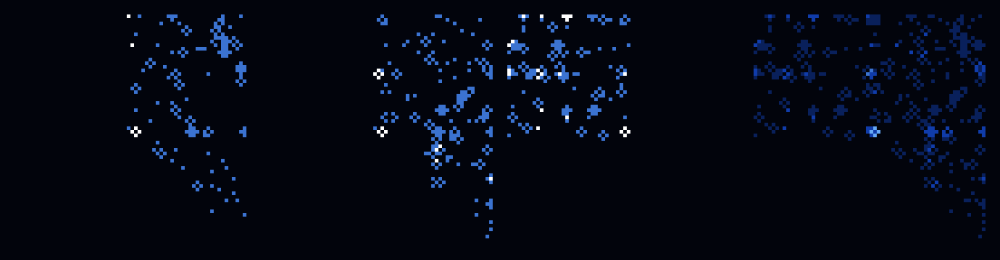

# Mythos as the trits themselves

The Mythos blue star (`ACER-MYTHOS-BLUE.gguf`) is turned into trits. Twenty-seven
copies of it then become the occupancy trits of the nested ternary network from
[Neural-network-inside-a-neural-network-using-trits-to-resolve-Finiteness](https://github.com/JesseBrown1980/Neural-network-inside-a-neural-network-using-trits-to-resolve-Finiteness).
The star is the network's state. Each of the 27 star copies is one outer node,
and inside every cell the 288-gate ternary network runs on the star's own trits.

Rust 1.81 with clippy (`-D warnings`), integer only, no `f32`/`f64`, no JSON, no
Node. Receipts are HBP/HBI with SHA-256, and every receipt line ends in `json=0`.



**Figure.**
- **Top:** density (the sum of the 27 trits per cell, slices A + B + C) at
  t = 0, 4, 24, 72 and 192 with the Taylor–Green gate set. The gold-framed panel
  is the state after 72 ticks forward and 72 back: the star restored exactly.
- **Bottom:** the 27 outer modes over 193 ticks. The rest-channel copy is gold.

## 1. The star

| | |
|---|---|
| File | `star/ACER-MYTHOS-BLUE.gguf`, 50,752 B |
| sha256 | `3dd92a42160a38c121980957ce9eabbea216678892801d7ea3ed4e99e96c3aae` |
| Header | GGUF v3, 9 keys, `general.architecture = asolaria-three-beings-rgb`, `asolaria.channel = BLUE`, `asolaria.centre = [32, 32, 33]` |
| Tensors | `slice_A`, `slice_B`, `slice_C` (64 × 64 F32), `radial_A/B/C` (64 F32); header plus tensors account for all 50,752 bytes |



## 2. Star → trits

[`src/star.rs`](src/star.rs) reads the three slices and assigns each cell a trit
from the raw IEEE-754 bit pattern, compared as an integer. Positive floats order
exactly like their `u32` bits, so no floating-point value is ever formed.

| Bits | Trit |
|---|---|
| `0` | 0 |
| `1 … 0x3F800000` (value in (0, 1.0]) | 1 |
| above `0x3F800000` (value > 1.0) | 2 |

Result: 12,288 cells give 11,763 zeros, 485 ones and 40 twos. The trit sum of one
star is **565**. `star.trits` sha256 is `748ebf67136c3c1c4e344f22dbe2b1ce600cc480900c2c74ca3a6468fccbe0ee`.
The 525 non-zero trits equal the 153 + 195 + 177 lit cells of slices A, B and C.

## 3. The nested network

**Inner network (every cell).** The lattice is the star's own shape: 64 × 64 × 3
= 12,288 periodic cells, with z running over slices A, B and C. Each cell has the
27 D3Q27 channels c_k ∈ {−1, 0, 1}³. Channel k of cell x holds the star seen
through that stencil offset:

```text
n_k(x) = star(x + c_k)
```

So the lattice holds **27 shifted copies of the star, one per channel**:
331,776 trits.

The gates ([`src/lattice.rs`](src/lattice.rs)) are the repository's own network:
288 four-channel involutive gates sorted by mass, momentum and 2E, 32 per cell
per tick, then streaming. The Rust gate tables are byte-identical to the
repository's C++ construction; their sha256 values are pinned in
[`tests/receipts.rs`](tests/receipts.rs).

**Outer network** ([`src/outer.rs`](src/outer.rs)). The 27 channel masses
M_k = Σ_x n_k(x), one per star copy, are the 27 shell modes u_n of the outer
ternary recurrence over F_P, P = 1,000,081. Its free centre, the all-ones
direction, is the total Q = Σ M_k. That is the inner network's conserved mass.

**Two gate sets, both from the repository.**

| Set | Rule | Gate table sha256 |
|---|---|---|
| `v1` | the pairing rule of `asolaria_ternary_fluid_v1.cpp` | `bd689114…` |
| `tg` | the Taylor–Green rule of `asolaria_taylor_green_regularity.cpp`: code 40 = (1,1,1,1) is held fixed in every gate | `a7fca71a…` |

## 4. Results

All numbers are from [`results/RESULT.hbp`](results/RESULT.hbp). Every run is
integer-only and deterministic.

| Measurement | `tg` | `v1` |
|---|---|---|
| Mass at t = 0 | 15,255 = 27 × 565 | 15,255 = 27 × 565 |
| Momentum (px, py, pz), 2E | (0, 0, 0), 30,510 | (0, 0, 0), 30,510 |
| Mass, momentum, 2E exact at every tick, t = 0…192, free and gated | PASS | PASS |
| Trits differing from the start at t = 72 | 27,193 | 27,260 |
| 72 ticks forward, 72 back: all 331,776 star trits restored | PASS | PASS |
| Uniform all-ones lattice unchanged after 72 ticks | **1** | **0** |
| Outer Q, all 193 ticks | 15,255 | 15,255 |
| Jacobian rank mod P, all 193 ticks | 26 | 26 |
| 1ᵀJ = 0 and Σ NL_n ≡ 0, all ticks | PASS | PASS |
| Outer drift law Q(u_t) + t·ν·D ≡ Q(u_0), 243 steps from the t = 192 readout, D = 883,973 | PASS | PASS |

**The 27 outer modes.** All copies start equal at 565, a point on the free-centre
line. The gates then move trits between copies. The spread max − min across the
27 modes (`tg`) is 0 → 143 at t = 1, peaks at 257 at t = 21, and is 64 at t = 192.
The sum stays 15,255 throughout.

**Focus at t = 1.** With collisions off, one streaming tick carries every
channel back onto the star: n_k(x + c_k) = star(x + c_k). All 331,776 slots then
equal the star trit under them, so the 27 copies coincide on one star. Free
streaming returns to the exact starting state at t = 192 = lcm(64, 3).

**The uniform fixed point belongs to the Taylor–Green gate set.** In `v1`, none of
the 288 gates maps code 40 to itself, so a uniform lattice changes on the first
collision pass. In `tg`, code 40 is held in every gate and the uniform lattice
stays put. Both sets conserve mass, momentum and energy exactly and are exactly
reversible on the star.

## 5. The first version

The first version of this experiment (commit `95402d2`) ran in C++ and Python. It
is kept unchanged in [`history/cxx-python-2026-10-31/`](history/cxx-python-2026-10-31/)
with its own `SHA256SUMS`.

The Rust version reproduces it exactly:
- all 386 per-tick rows of both gate sets (27 modes, Q and alignment, free and
  gated);
- both density-frame files, byte for byte;
- the star trits.

[`tests/receipts.rs`](tests/receipts.rs) checks this on every build.

## 6. Reproduce

```sh
cargo clippy --release --all-targets -- -D warnings
cargo test --release
cargo run --release -- star/ACER-MYTHOS-BLUE.gguf out
cd out && sha256sum -c ../results/SHA256SUMS
```

The run takes about 8 seconds. CI ([`.github/workflows/ci.yml`](.github/workflows/ci.yml))
installs Rust 1.81.0 and then:
- fails on any `f32`/`f64`, JSON, JS or Node file;
- runs clippy and the tests;
- checks the star's sha256;
- reruns the experiment into a fresh folder and checks every file against the
  committed `results/SHA256SUMS`. `results/` itself is never rewritten.

| Path | Contents |
|---|---|
| `star/` | the blue star GGUF and its sha256 sidecar |
| `src/gguf.rs`, `src/star.rs` | GGUF v3 reader with integer magnitudes; star → trits; the 27 copies |
| `src/lattice.rs` | D3Q27 gates (both sets), streaming, inverse |
| `src/outer.rs` | outer 27-mode network over F_P: Jacobian, rank, drift law |
| `src/sha256.rs`, `src/hbp.rs`, `src/png.rs` | SHA-256, HBP/HBI receipts, integer PNG writer |
| `src/main.rs` | the experiment and the figures |
| `results/` | `RESULT.hbp`, `SERIES-tg.hbp` and `SERIES-v1.hbp` (every tick: 27 modes, Q, alignment), `rho-frames-*.bin` (density every 4 ticks, 49 × 3 × 64 × 64), `star.trits`, the two figures, `INDEX.hbi`, `SHA256SUMS` |
| `history/cxx-python-2026-10-31/` | the first version and its receipts |

Operator: Jesse Daniel Brown.
